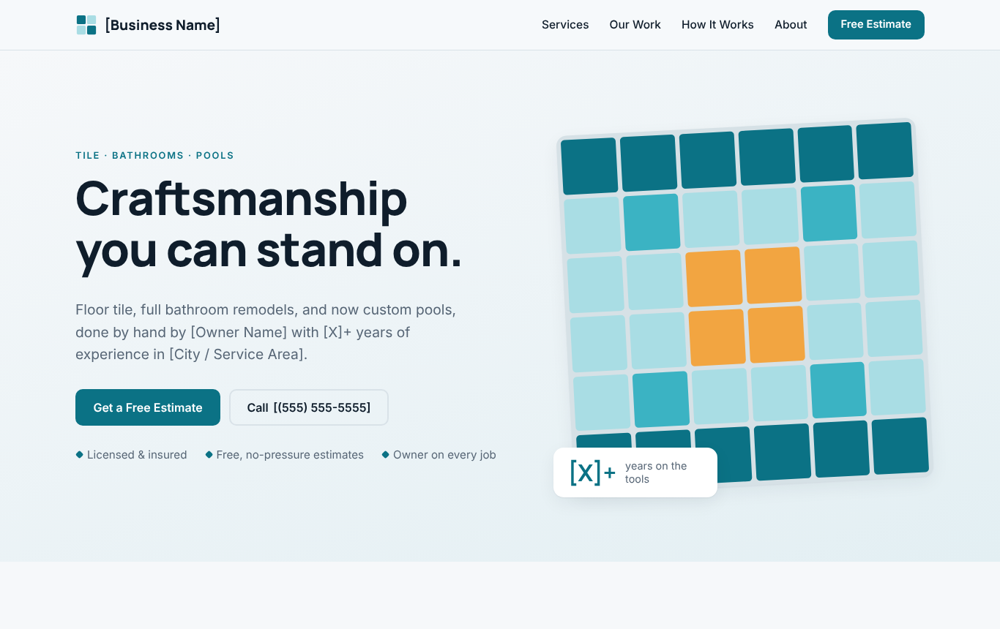
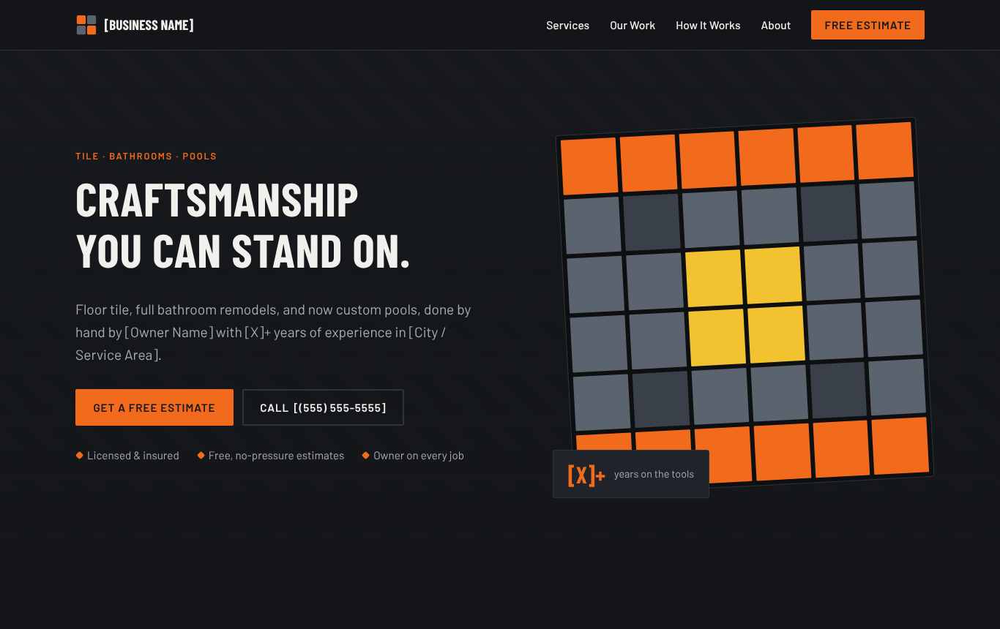
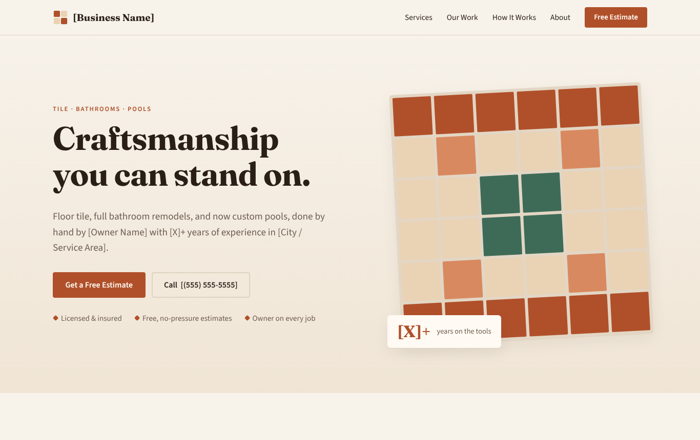

# Design mockups

Three design directions for the same site. Same content and layout, different look.
They're screenshots of `index.html?theme=...`. Re-take them after changes with any browser.

| Direction | Feel | Header | Full page | Phone |
| --- | --- | --- | --- | --- |
| **Modern** (default) | Clean, bright, pool-water teal | [hero](modern-hero.png) | [full](modern-desktop.png) | [phone](modern-mobile.png) |
| **Rugged** | Dark and bold, construction orange | [hero](rugged-hero.png) | [full](rugged-desktop.png) | [phone](rugged-mobile.png) |
| **Craftsman** | Warm terracotta, classic serif type | [hero](craftsman-hero.png) | [full](craftsman-desktop.png) | [phone](craftsman-mobile.png) |

